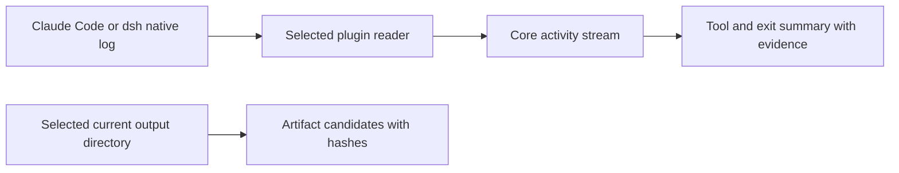

# Agent activity observation

This consumer collects key actions from a selected native Agent session, retains
them in Core, and derives useful facts without asking the model to report its own
history. It uses Agent 0.4.5 and the Core activity contract introduced on 2026-10-25.
The existing application bridge and its `NativeActivity` history remain independent.



## Run the collector

Build the Agent plugin (`npm run build --workspace plugins/agent`) and explicitly
select a Core binary implementing [activity observations](../../../Rho-core/docs/ACTIVITY.md).
An observation-only Host needs no executor. Use a fresh state directory: Core
format 4 refuses older stores intact. Do not replace or restart an existing Host.

```sh
rho-core serve --project /absolute/project --state-dir /absolute/new-state
# In another terminal, use the same project and the original native session ID:
rho-agent-observe collect --core /absolute/rho-core \
  --socket /absolute/new-state/host.sock --caller researcher --stream trial-1 \
  --producer claude --project /absolute/project --session ORIGINAL_SESSION_ID \
  --source /absolute/selected-session.jsonl --watch-seconds 300
rho-agent-observe summary --core /absolute/rho-core \
  --socket /absolute/new-state/host.sock --caller researcher --stream trial-1 \
  --project /absolute/project --outputs outputs
```

In a source checkout, `node plugins/agent/dist/activity-cli.js` is the same CLI.
For dsh select `--producer dsh --source /absolute/dsh-home/sessions` and
`--dsh-package /absolute/@deepseek-ai/dsh/package.json`. The package is supplied by
the selected installed dsh, not downloaded or bundled by this plugin. The reader
mounts only dsh's session and JSONL persistence services, then opens the original
session in `read` mode. Default compression is `zstd`; select `--compression none`
only when that is the source's actual storage configuration.

The collector checks the Core project, native project/session, immutable source
selection and normalization version. Each scan reconstructs a bounded source
prefix, compares the acknowledged normalized prefix hash, and appends only its
new suffix. Core is the checkpoint; no second journal or model resume is needed.
Restart with exactly the same options and `--stream`. Replaced/truncated sources,
changed acknowledged content, malformed complete records and incompatible parser
selections fail explicitly. The last retained Core history stays readable.
An incomplete final Claude JSONL line waits for a later scan. Missing evidence is
not an empty successful result. A new stream is an explicit new selection, not a
repair for lost acknowledgement or a reason to rerun an external tool.

## Captured facts and limits

The default capture includes tool/call identity, commands, paths, native time and
sequence when available, tool error/denial, and supported native exit markers.
It excludes model prose/reasoning and tool result bodies. `--content` additionally
selects bounded tool inputs and result bodies. Known credential keys and common
inline credential forms are redacted; this is best effort, not a secret detector.
Commands and selected bodies can themselves contain sensitive project content.

Claude supports tool requests/results and rejection facts in the selected session
JSONL; successful Bash returns do not supply an explicit exit code, so it stays
unknown. A failure's native `Exit code N` marker is recorded with its basis.
dsh supports tool calls/results, job registration/settlement and turn start/end.
Its job `completed` and tool `isError: false` do not imply process exit zero: the
job's `exit code: N` detail is retained separately. Native receipt order, native
clock and Core ingestion cursor retain separate meanings. This does not observe
all subprocesses, hidden reasoning, or effects absent from the selected log.

| Resource | Default and configuration | Exceeded behavior |
| --- | --- | --- |
| Native source bytes | `maxSourceBytes` / `--max-source-bytes`: 32 MiB | Refuse this scan; keep acknowledged Core history |
| Native records | `maxNativeEvents`: 32,768 in reader API | Refuse this scan; no source rewrite |
| Claude complete line | Fixed 1 MiB | Refuse malformed/oversized complete record; never skip it silently |
| Native correlation identity | Fixed 1 KiB per ID | Reject invalid/oversized identity; never clip it into a different identity |
| Captured value | `maxFieldBytes`: 8 KiB; 128 keys/items; depth 12 | Explicit `truncated` metadata; whole Unicode code points |
| Selected data before envelope | `maxEventBytes`: 32 KiB | Preserve native identity; omit oversized detail and mark truncation |
| Core payload and pages | Host's `Limits.activity` | Atomic rejection or retained suffix with explicit gap, per Core contract |
| Watch lifetime | `--watch-seconds`: 0 once, at most 86,400 s; interval 1,000 ms, selectable 100–60,000 ms | End observer only; SIGINT/SIGTERM interrupt its idle wait |
| Core CLI exchange | Fixed 15 s, reply 2 MiB | Fail with original identity retained; no automatic Agent execution |
| Current output scan | API: 64 files, 256 directory entries, 8 MiB/file, depth 4 | File size refusal is reported; count/depth/change errors stop the scan |

dsh's native persistence decoder may decompress/cache more than the stored byte
count before returning the bounded event page; these limits are not a hard heap
ceiling. Each watch scan currently rereads its bounded source prefix. Large or
rotated native histories require a separately designed reader/checkpoint policy.

Output inspection selects one directory strictly inside the canonical project,
refuses symlink traversal, skips symlink entries and checks file identity/change
around hashing. It does not establish an OS sandbox against a hostile concurrent
filesystem actor. Hashes describe current bytes only. A table/figure extension is
a hint; scientific correctness and rendered appearance require their own checks.
The summary exposes retention `gap` and leaves requests without results unknown.
It executes no suggested repairs or commands found in event content.

## Reproduce acceptance

Use disposable projects and selected client versions. Run an Agent task that
reads `input.csv`, fixes integer division in group means, writes
`outputs/summary.csv` and `outputs/plot.svg`, and invokes an intentional command
that exits 7 exactly once. Point this check at its retained native session:

```sh
node examples/agent-observation/acceptance.mjs \
  --core /absolute/rho-core --producer claude --project /absolute/project \
  --session ORIGINAL_SESSION_ID --source /absolute/selected-session.jsonl \
  --out /absolute/local-evidence.json
```

For dsh pass the same source/package selection described above. The script owns
its fresh Host/state, checks actual native backfill and summary, repeats collection,
SIGKILLs and restarts only that Host, checks identical retained events, and verifies
that managed-run history stays empty. It never starts the Agent or its tools.
Run normalizer/reader checks with `node --test test/activity-observation.test.mjs`.
Actual native and live-attachment observations are recorded in [Acceptance](ACCEPTANCE.md).
